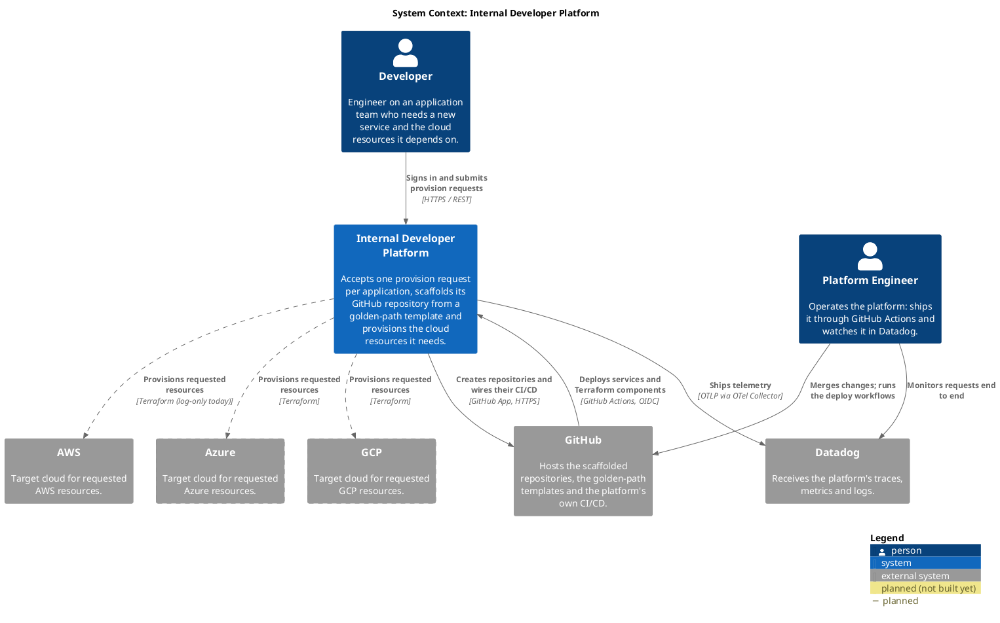
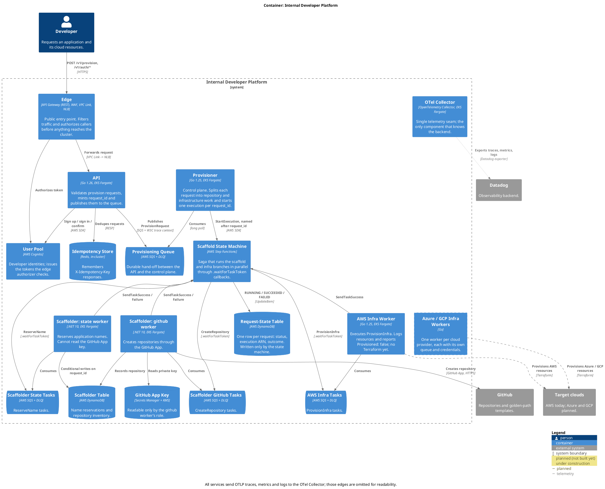
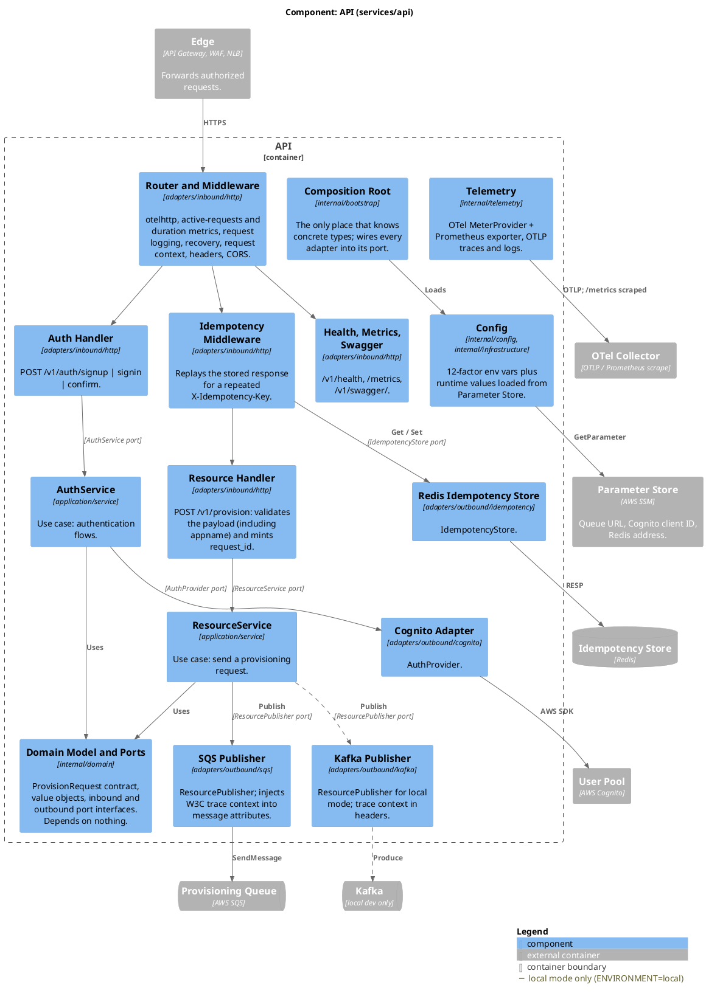
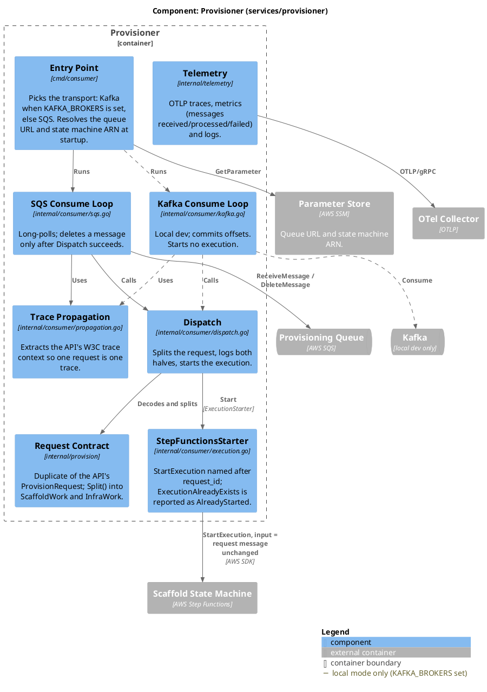
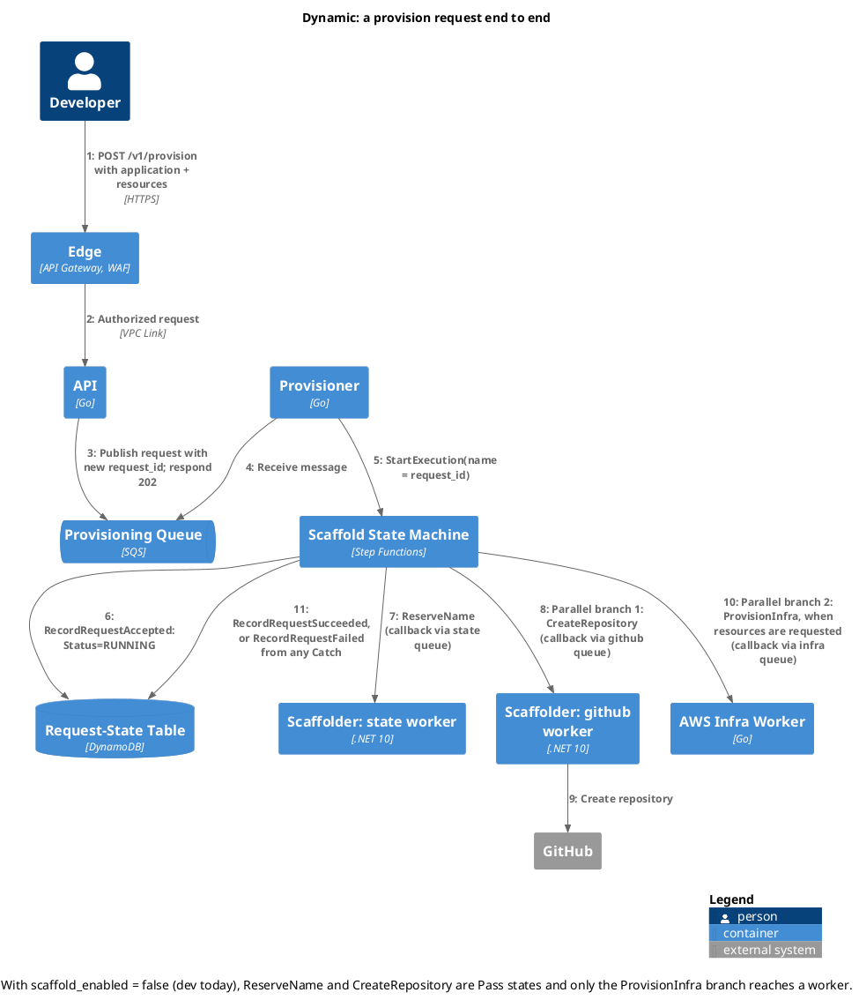
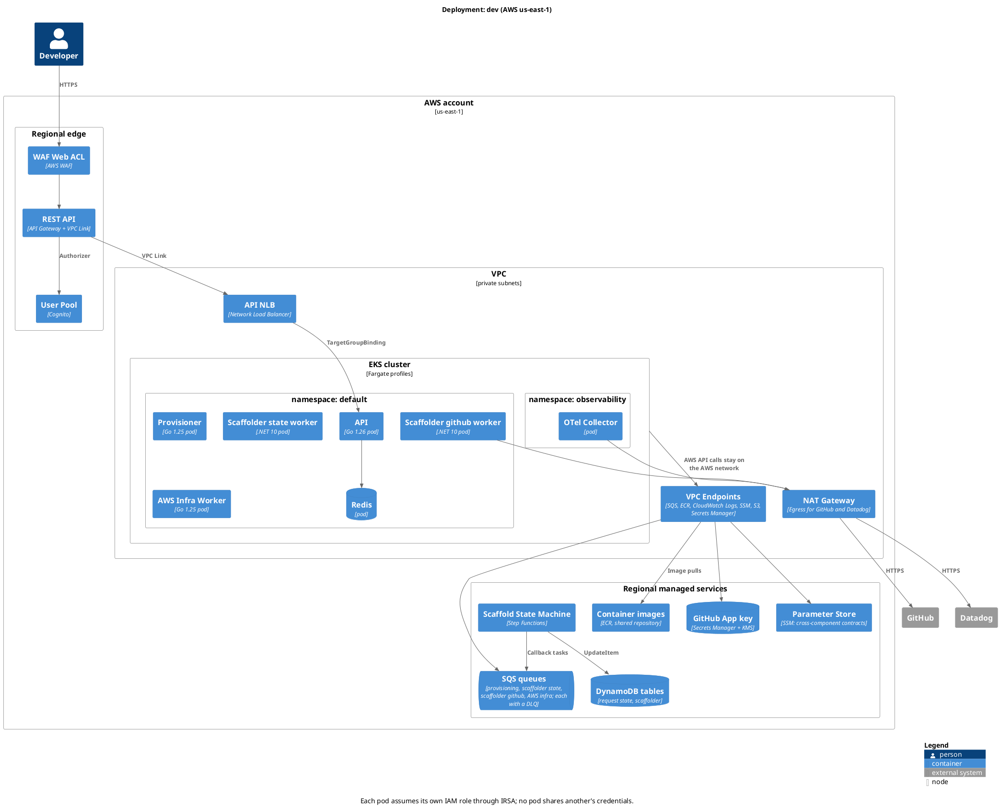

# Internal Developer Platform

> A cloud-native, event-driven platform that lets engineering teams self-service cloud
> infrastructure — provisioning resources on demand through a single REST API.

Built as a microservices system on AWS, this project demonstrates production-grade
patterns in distributed systems design: asynchronous messaging, service decoupling,
and infrastructure-as-code.

---

## Why this project

Platform engineering teams spend enormous effort giving developers a paved road to cloud
resources without sacrificing control or visibility. This IDP tackles that problem end to end:

- **Self-service provisioning** — developers request resources through a single REST API instead of filing tickets or writing Terraform by hand.
- **Event-driven decoupling** — the API never blocks on slow cloud operations; work is handed off through a durable message queue.
- **Production-grade observability** — metrics, logs, and distributed traces flow through an OpenTelemetry Collector into Datadog, so every request is traceable end to end.

---

## Architecture

An event-driven system designed for resilience and independent scaling. The
diagrams below follow the [C4 model](https://c4model.com); their PlantUML sources
live in [`docs/architecture/c4/`](docs/architecture/c4/) and are rendered with
`docs/architecture/c4/render.sh`.

**Message flow:** `API → SQS → Provisioner → Step Functions → task workers`

Decoupling the write path (API) from the control plane (Provisioner) via SQS, and the
control plane from the workers via Step Functions callbacks, means each service
scales, deploys, and fails independently — a core tenet of reliable distributed systems.

### System context

Who uses the platform and which external systems it depends on.



### Containers

The deployable units and how a request moves between them. The API publishes one
request carrying both the application and its cloud resources; the Provisioner
starts one Step Functions execution per request, which sends the repository work to
the Scaffolder and the infrastructure work to the per-cloud infra worker.



### Components

The API is hexagonal (ports and adapters) with a single composition root:



The Provisioner is the control plane: it splits each request and starts its execution:



### A provision request end to end



### Deployment

Every workload runs on EKS Fargate in private subnets; AWS API calls go through VPC
endpoints and only GitHub and Datadog traffic leaves through the NAT gateway.



---

## Tech Stack

| Domain            | Technologies                                              |
|-------------------|-----------------------------------------------------------|
| **Languages**     | Go (API, Provisioner)                                     |
| **Compute**       | AWS EKS on Fargate, Kubernetes                            |
| **Networking**    | VPC with private subnets, interface + gateway VPC endpoints, NAT gateway |
| **Messaging**     | AWS SQS (production), Kafka (local dev)                   |
| **Infra as Code** | Terraform (`modules/` + `live/` pattern)                 |
| **Auth**          | AWS Cognito                                               |
| **Observability** | Datadog, AWS X-Ray                                        |
| **CI/CD**         | GitHub Actions                                            |

---

## Engineering Highlights

- **Asynchronous, at-least-once processing** built on SQS for durability and back-pressure tolerance.
- **Infrastructure as code** — the entire AWS footprint (EKS, SQS, Cognito) is reproducible through Terraform.
- **Runs serverless-ly** on EKS + Fargate — no node management, pay-per-pod.
- **Private-by-default networking** — workloads in the private subnets reach AWS services (SQS, ECR, CloudWatch Logs, SSM, S3 and Secrets Manager) over VPC endpoints rather than the public internet. The NAT gateway remains for third-party services that have no AWS-network path, such as GitHub and Datadog.
- **First-class observability** with Datadog metrics and distributed tracing via AWS X-Ray.

---

## Repository Layout

```
services/
  api/                Go REST API — accepts requests, publishes to SQS
  provisioner/        Go service — provisions cloud resources from SQS
infra/                Terraform modules and live environments
docs/adr/             Architecture decision records
docs/architecture/c4/ C4 diagrams: PlantUML sources and rendered PNGs
k8s/                  Kubernetes manifests
k6/                   Load-testing scripts
.github/workflows/    CI/CD pipelines — see .github/workflows/README.md
.github/actions/      Composite actions shared by the workflows
```

Workflow filenames encode when they run: `ci-` on pull requests, `cd-` to ship,
`ops-` for manual operator actions, `_` for internal reusable pipelines.
[`.github/workflows/README.md`](.github/workflows/README.md) documents the
triggers, IAM roles, approval gates and a from-scratch runbook.

---

## Running Locally

Spin up the full stack (Kafka + Zookeeper + services + OTel Collector) with Docker Compose:

```bash
docker compose -f docker-compose.dev.yaml up
```

**Observability locally:** an OpenTelemetry Collector receives OTLP from the
services and scrapes the API's `/metrics`. Inspect the pipeline with:

```bash
docker compose -f docker-compose.dev.yaml logs -f otel-collector  # telemetry (debug exporter)
curl http://localhost:8889/metrics                                # collected metrics
```

Run individual services:

```bash
# API (Go)
cd services/api && go run cmd/server/main.go

# Provisioner (Go)
cd services/provisioner && go run cmd/consumer/main.go
```

Run the test suites:

```bash
cd services/api && go test ./...
cd services/provisioner && go test ./...
```

---

## Roadmap

- **Multi-cloud provisioning** — the API already validates requests for AWS, Azure, and GCP; the Provisioner currently targets AWS, with the other providers planned.
- **Cost tracking** — per-resource spend reporting, making cost a first-class signal alongside provisioning.
